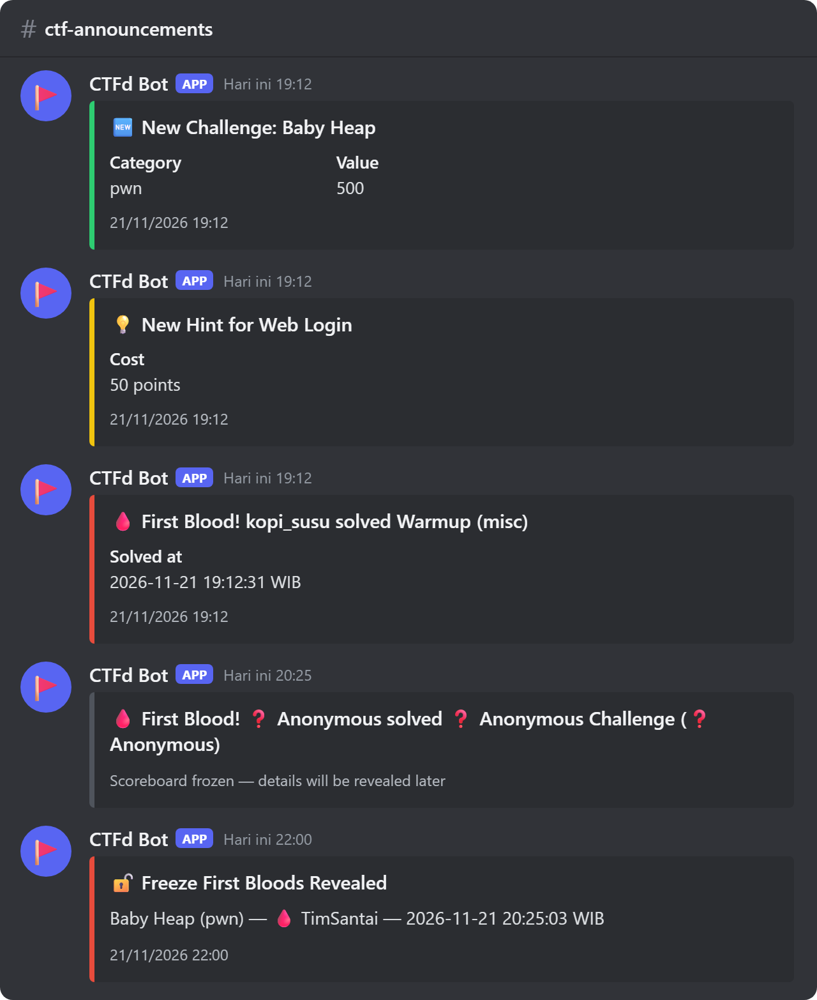
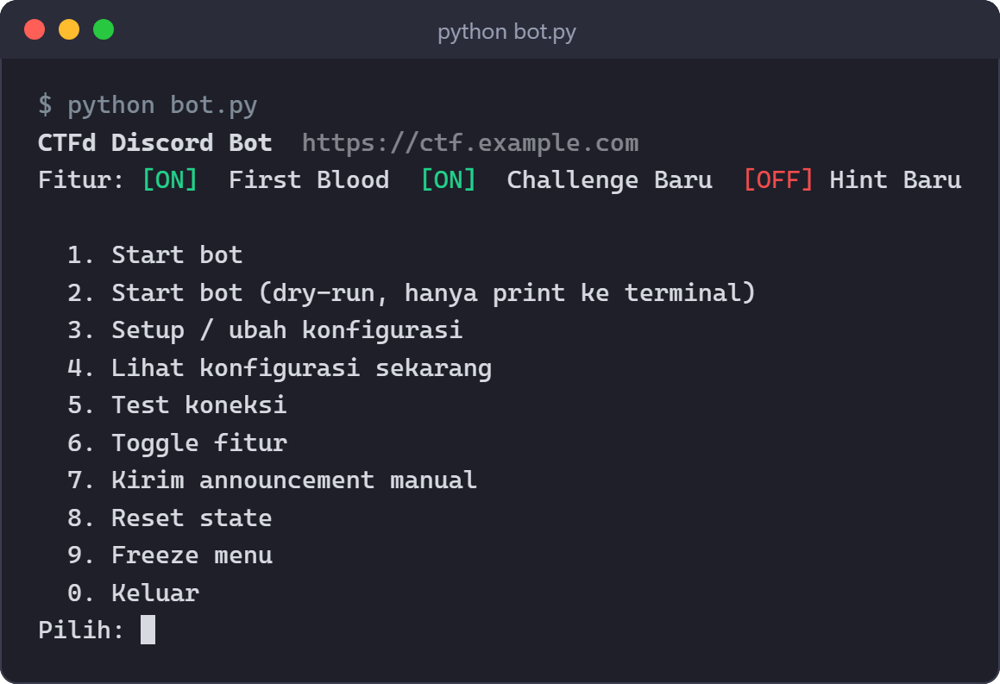
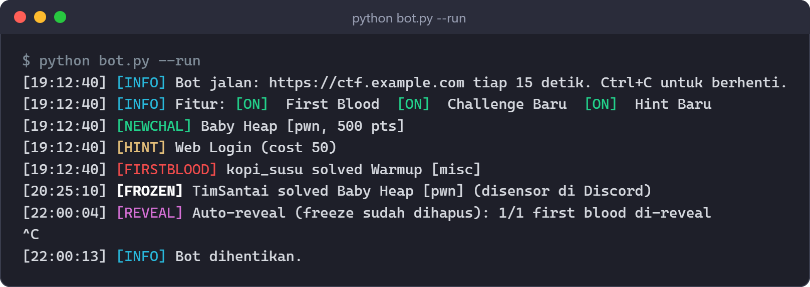

# CTFd First Blood Bot

Bot kecil untuk lomba CTF yang memakai **CTFd**. Bot ini memantau CTFd lalu otomatis mengirim pengumuman ke **Discord**:

- 🩸 **First Blood**: tim pertama yang berhasil solve sebuah challenge
- 🆕 **Challenge baru**: saat panitia membuka challenge baru
- 💡 **Hint baru**: saat panitia menambah hint
- 🧊 **Mode freeze**: saat scoreboard di-freeze, nama tim dan challenge di first blood disembunyikan, lalu bisa dibuka lagi setelah freeze selesai

Cukup satu file (`bot.py`), dipakai lewat menu angka. Tidak perlu hafal perintah apa pun.

## Contoh

Pesan yang muncul di Discord:



Menu saat bot dijalankan:



Catatan di terminal saat bot berjalan:



> Gambar di atas hanya contoh dengan data fiktif.

## Yang perlu disiapkan

- Python 3.8 atau lebih baru
- Akun **admin** di CTFd
- Channel Discord untuk pengumuman

## Cara pakai

**1. Download dan install**

```bash
git clone https://github.com/PocariKaleng/CTFd-First-Blood-.git
cd CTFd-First-Blood-
pip install -r requirements.txt
```

**2. Jalankan**

```bash
python bot.py
```

Saat pertama kali dijalankan, bot akan meminta 3 hal: **URL CTFd**, **token admin CTFd**, dan **webhook Discord**. Cara mendapatkannya ada di bawah.

**3. Tes, lalu start**

Pilih **5** untuk mengecek koneksi (bot akan mengirim pesan tes ke Discord), lalu pilih **1** untuk mulai. Tekan `Ctrl+C` untuk berhenti.

Saat start pertama kali, bot bertanya *"Announce data yang sudah ada?"*. Tekan **Enter** saja supaya challenge dan solve lama tidak dikirim ulang ke Discord.

### Cara ambil token admin CTFd

1. Login ke CTFd pakai akun admin.
2. Buka **Settings → Access Tokens**.
3. Klik **Generate**, lalu salin tokennya. Token hanya muncul sekali.

### Cara bikin webhook Discord

1. Di Discord, klik ikon gerigi di channel tujuan (**Edit Channel**).
2. Buka **Integrations → Webhooks → New Webhook**.
3. Klik **Copy Webhook URL**.

## Isi menu

| No | Fungsi |
|---|---|
| 1 | Start bot |
| 2 | Start bot versi coba-coba: pesan hanya muncul di terminal, tidak dikirim ke Discord |
| 3 | Ubah pengaturan (URL, token, webhook, interval, dll.) |
| 4 | Lihat pengaturan sekarang (token dan webhook disensor) |
| 5 | Tes koneksi ke CTFd dan Discord |
| 6 | Nyalakan/matikan First Blood, Challenge Baru, atau Hint Baru |
| 7 | Kirim pengumuman bebas ke Discord |
| 8 | Reset catatan bot |
| 9 | Menu freeze |
| 0 | Keluar |

## Mode freeze

- Bot otomatis membaca waktu freeze dari CTFd. Kalau perlu, waktu freeze bisa diisi manual lewat **menu 9**.
- First blood yang terjadi **setelah** freeze dikirim tanpa nama tim dan tanpa nama challenge.
- Data aslinya tetap disimpan. Setelah freeze selesai, buka **menu 9 → 6** untuk mengumumkan semuanya sekaligus, atau nyalakan **auto-reveal** di **menu 9 → 4** supaya dikirim otomatis.

## Menjalankan bot terus-menerus di server

Isi pengaturan dulu dengan `python bot.py`, lalu jalankan dengan `--run` supaya bot langsung start tanpa menu:

```bash
nohup python bot.py --run > bot.log 2>&1 &
```

Atau pakai `screen`:

```bash
screen -S ctfbot
python bot.py --run
# keluar dari screen tanpa mematikan bot: Ctrl+A lalu D
```

## Penting

- `config.json` berisi token dan webhook. **Jangan dibagikan atau di-upload.** File ini sudah dikecualikan lewat `.gitignore`.
- `state.json` berisi catatan bot, termasuk nama tim yang disembunyikan saat freeze. Jangan dibagikan selama freeze.
- Challenge yang punya *prerequisite* (harus solve challenge lain dulu) tidak terdeteksi oleh bot.
- Kalau opsi "tampilkan isi hint" dinyalakan, hint berbayar ikut terbaca gratis di Discord.
